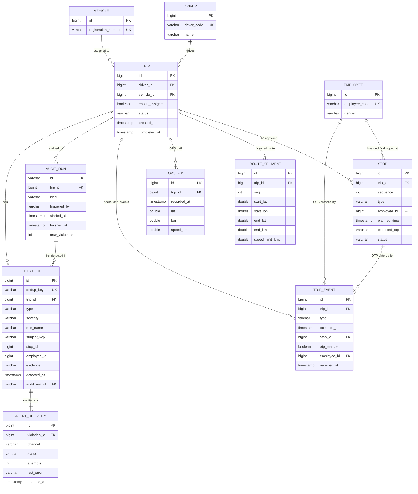

# Trip Safety & Compliance Audit Engine

## Overview
This service is a trip safety and compliance audit engine for employee transport fleets (such as corporate cab services). It verifies operational compliance across completed trips against regulatory and safety policies:
- **Night Safety**: Ensuring female employees travelling late at night are not picked up first or dropped off last alone without a security escort.
- **Drop OTP Verification**: Verifying that drops have recorded matching OTPs, freezing drops on mismatch, and flagging missing OTPs.
- **Route Deviation**: Detecting cab movement straying off the planned polyline route beyond acceptable tolerances.
- **Over-Speed**: Catching sustained driving speeds exceeding segment-specific speed limits, distinguishing standard violations from extreme over-speeding.
- **Emergency SOS**: Providing an immediate fast-path endpoint for employee panic presses with live GPS coordinates.

The system is built with **Java 21**, **Spring Boot 4.1.1**, and file-mode **H2**.

---

## Quick start (JDK 21, run, test)

### Requirements
- **Java 21** (JDK 21+)
- Maven wrapper is included (`./mvnw` on Linux/macOS, `.\mvnw.cmd` on Windows)

### Running the Application
To start the application locally:
```bash
# On Linux / macOS
./mvnw spring-boot:run

# On Windows PowerShell / Command Prompt
.\mvnw.cmd spring-boot:run
```
The application runs on `http://localhost:8080`.

Under the `dev` profile (active by default), a startup data seeder (`SeedDataLoader`) initializes 5 pre-configured demo trips with completed stops, planned routes, and 30-second GPS trails:
- **Trip 1 (`TRIP-A-NIGHT-SAFETY`)**: Woman dropped alone at 23:10 without an escort.
- **Trip 2 (`TRIP-B-ROUTE-DEVIATION`)**: Cab 800m off-route for 4 minutes.
- **Trip 3 (`TRIP-C-OTP-MISMATCH`)**: Drop stop with an entered OTP mismatch, freezing the stop.
- **Trip 4 (`TRIP-D-OVERSPEED`)**: Sustained driving speed at 65 km/h in a 40 km/h zone (>1.5x limit).
- **Trip 5 (`TRIP-E-CLEAN`)**: Fully compliant trip with zero violations.

### Running the Test Suite
To execute the complete automated test suite:
```bash
# On Linux / macOS
./mvnw test

# On Windows
.\mvnw.cmd test
```

---

## Architecture (layers and the rules-in-actions-out idea)

The application follows a strict layered structure.
```
api  -->  service  -->  repository
             |
             +--> rules  -->  detect
             +--> alert
             +--> audit
```

### Layer Breakdown
- **`api`**: REST controllers and Java record DTOs (`TripController`, `AuditController`, `SosController`, `ViolationController`). Responsible solely for JSON validation, request parsing, and HTTP status codes. No business logic resides here.
- **`service`**: (`TripService`, `AuditService`, `SosService`, `ViolationRecorder`). Responsible for database interactions, transactional boundaries.
- **`rules`**: Pure domain safety rules implementing the `SafetyRule` interface (`NightSafetyRule`, `OtpAtDropRule`, `RouteDeviationRule`, `OverSpeedRule`). Rules are stateless and have no repository dependencies.
- **`detect`**: algorithmic and geometric math (`GeoMath`, `RouteMatcher`, `GpsTrail`, `SustainedConditionDetector`). Reusable point-to-segment calculations and time-series run detection.
- **`alert`**: Alert severity mapping (`AlertRoutingPolicy`), transactional outbox dispatching (`AlertDispatcher`), and channel implementations (`SmsNotifierStub`, `EmailNotifierStub`, `DashboardNotifier`) created via `NotifierFactory`.
- **`domain`**: JPA entities and enums.
- **`repository`**: Spring Data interfaces with explicit query methods.
- **`exception`**: Centralized `@RestControllerAdvice` (`GlobalExceptionHandler`).

---

## ER diagram (Mermaid, matching the final entities)

The database schema uses plain foreign key IDs.



---

## API summary table

All API endpoints are prefixed with `/api/v1` and communicate via JSON.

| Method | Path | Status | Purpose |
|---|---|---|---|
| `POST` | `/api/v1/trips` | `201 Created` | Create a trip with ordered stops, route polyline segments, driver, vehicle, and employees. |
| `POST` | `/api/v1/trips/{id}/gps` | `200 OK` | Ingest batch of GPS fixes. Discards timestamp duplicates. Returns `409 Conflict` if trip is completed. |
| `POST` | `/api/v1/trips/{id}/events` | `201 Created` | Ingest operational events (`OTP_ENTERED`, `ESCORT_ASSIGNED`, `ESCORT_REMOVED`, `TRIP_COMPLETED`). |
| `POST` | `/api/v1/trips/{id}/sos` | `201 Created` / `200 OK` | Fast-path panic button press. Creates an immediate `CRITICAL` violation and dispatches alerts. |
| `POST` | `/api/v1/trips/{id}/audit` | `200 OK` | Runs compliance audit. Safe to repeat (idempotent). Requires trip to be `COMPLETED` (returns `409` if active). |
| `GET` | `/api/v1/trips/{id}/violations` | `200 OK` | Retrieve all detected violations for a specific trip. |
| `GET` | `/api/v1/violations/{id}` | `200 OK` | Retrieve a single violation by ID, including delivery status across notification channels. |

Detailed request/response payloads and Windows/Unix-safe curl commands are provided in [docs/api-examples.md]
---

### Rule Logic Summary
1. **`NIGHT_SAFETY`** (`HIGH` -> `TRANSPORT_MANAGER`):
   - Triggers if a trip has no escort in effect at the stop's planned time, the planned time is inside the night window, and either:
     - The first pickup is a female employee, or
     - The last drop is a female employee and she is the only passenger remaining onboard.
   - Escort status is calculated chronologically from initial trip assignment plus any `ESCORT_ASSIGNED` / `ESCORT_REMOVED` events occurring before that stop.
2. **`OTP_MISMATCH`** (`HIGH` -> `TRANSPORT_MANAGER`):
   - At ingest, entered OTP is compared against expected OTP in constant time. A mismatch immediately sets the stop status to `FROZEN`.
   - At audit time, any drop with a failed attempt (`otpMatched == false`) emits an `OTP_MISMATCH` violation (reason `MISMATCH`).
   - Any completed drop with zero OTP events emits an `OTP_MISMATCH` violation (reason `MISSING`).
3. **`ROUTE_DEVIATION`** (`HIGH` -> `TRANSPORT_MANAGER`):
   - Computes flat plane distance from each GPS fix to the nearest segment on the route polyline.
   - Using `SustainedConditionDetector`, finds runs where distance > 500m lasting at least 120s with pings no more than 60s apart.
   - Single-ping blips are discarded. Reports the segment index where the vehicle departed the route.
4. **`OVER_SPEED`** (`MEDIUM` or `CRITICAL` -> `DASHBOARD` or `CONTROL_ROOM` + `TRANSPORT_MANAGER`):
   - Matches each fix to its nearest segment and evaluates against that segment's speed limit.
   - Runs where speed > limit lasting at least 30s trigger a violation. Single spikes are discarded.
   - If peak speed in the run exceeds `limit * 1.5`, severity is escalated to `CRITICAL`.
5. **`SOS`** (`CRITICAL` -> `CONTROL_ROOM` + `TRANSPORT_MANAGER`):
   - Emergency panic event raised via `/sos`. Finds the latest GPS fix recorded at or before the press and dispatches immediate alerts carrying live coordinates.

---

## Idempotency and immutability

### Deterministic Deduplication Keys
To ensure that re-running an audit never duplicates records or sends duplicate alerts, every violation is assigned a deterministic deduplication key derived in the `Violation` constructor:
```java
dedupKey = sha256Hex(tripId + "|" + type + "|" + subjectKey)
```

### Database Enforcement
- The `VIOLATION` table declares a `UNIQUE` constraint on `dedup_key`.
- `ViolationRecorder` inserts violations in dedicated, isolated transactions.
- If two audits run concurrently and encounter the same violation, the second insert fails the unique key check. The exception is caught outside the recorder's transaction and safely treated as `EXISTING`.
- Re-auditing a trip returns existing violations and dispatches **0 new alerts**.

### Immutability
Violations represent immutable safety records:
- The `Violation` class is annotated with `@Immutable` and contains no setter methods.
- There are no HTTP endpoints to modify or delete violations.

---

## Time and space complexity of the core logic

### Route Matching and Detection
- **Point-to-Segment Matching**:
  For each GPS fix, flat-plane projection onto a segment requires $O(1)$ vector arithmetic.
  Given $F$ GPS fixes and $S$ route segments, finding the nearest segment for all fixes is **$O(F \times S)$** time.
  Because an average trip polyline has tens of segments ($S \le 50$), this runs in milliseconds.
- **Sustained Condition Detector**:
  Both route deviation and over-speed detection run over cleaned fixes using `SustainedConditionDetector`.
  The detector processes fixes in a single forward pass: **$O(F)$ time** and **$O(1)$ auxiliary memory** (storing only detected runs).
- **GPS Normalization**:
  Sorting raw fixes by timestamp is **$O(F \log F)$**, followed by an **$O(F)$** linear scan to eliminate duplicate timestamps.
- **Night Safety & OTP**:
  Walking stops and events requires **$O(N + E)$** time where $N$ is stops ($N \le 10$) and $E$ is events.
- **SOS Nearest Fix Lookup**:
  Finding the latest fix at or before panic press is an **$O(\log F)$** indexed query over `recorded_at`.

---

## Trade-offs (H2 vs Postgres, O(F*S) route matching, plain-text expected OTP in the DB)

1. **H2 vs. PostgreSQL**:
   - *Choice*: Embedded file-mode H2.
   - *Rationale*: Allows anyone to clone the repository and run the entire application and test suite immediately without installing external database servers or starting Docker containers.
   - *Trade-off*: PostgreSQL provides robust connection pooling.
2. **$O(F \times S)$ Route Matching**:
   - *Choice*: Linear scan over all polyline segments for every GPS fix.
   - *Rationale*: Keeps geometry code simple.
3. **Plain-Text Expected OTP in Database**:
   - *Choice*: Expected OTPs are stored as plain text on the `STOP` entity.
   - *Trade-off*: If a raw database snapshot were leaked, stored expected OTPs would be visible.

---

## Testing

The project has 115 automated tests covering all functional rules:

- **Rule Units** (`NightSafetyRuleTest`, `NightWindowTest`, `OtpAtDropRuleTest`, `RouteDeviationRuleTest`, `OverSpeedRuleTest`):
  - Midnight-crossing night windows (e.g., 22:00–06:00 flags 01:30 AM drop, excludes 21:59).
  - Mid-trip escort assignment and removal timeline evaluation.
  - Drop OTP mismatch and freeze status logic; drop with missing OTP flagged as HIGH.
  - Peak speed ratio calculations triggering MEDIUM vs. CRITICAL over-speed.
- **Integration & API** (`TripApiIntegrationTest`, `SosServiceIntegrationTest`, `EdgeCaseAuditIntegrationTest`):
  - Full trip lifecycle: creation, GPS batching, event recording, SOS alerting, and audit runs.
  - Rejection of GPS fixes and events after trip completion (`409 Conflict`).
  - Validation errors returning field names only without leaking rejected values.
  - End-to-end verification of all 5 seeded demo scenarios (Trip A through E).
- **Concurrency & Idempotency** (`AuditServiceConcurrencyTest`, `SafetyRulesAcceptanceTest`):
  - Re-auditing the same trip twice yields identical violations and zero duplicate alerts.

---

## Future work

- **Role-Based Authentication (Spring Security)**:
  Replacing the open configuration with stateless HTTP Basic / JWT authentication and an in-memory user manager supporting `ADMIN`, `APPROVER`, and `EMPLOYEE` roles. Enforcing `TripAccessGuard` so employees may raise SOS only for trips where they have an assigned stop.
- **Tamper-Evident Hash Chain**:
  Adding an append-only audit verification chain where each violation stores `hash = sha256(prevHash + canonicalPayload)` per trip, verifiable via `GET /api/v1/audit/verify/{tripId}`.

